<div align="center">

<br>


### 서울대학교 3D 캠퍼스 익스플로러

서울대학교 관악캠퍼스를 참고한 브라우저 기반 3D 탐방 프로젝트입니다.

지상·비행 이동, 건물 검색과 길안내, 순환셔틀, 상호작용, 사진 촬영과 멀티플레이어를 제공합니다.

<br>

[기능](#주요-기능) &nbsp; · &nbsp; [기술](#기술-구성) &nbsp; · &nbsp; [설계와 검증](#설계와-검증) &nbsp; · &nbsp; [제작 과정](#제작-과정과-역할) &nbsp; · &nbsp; [실행](#로컬-실행)

<br>

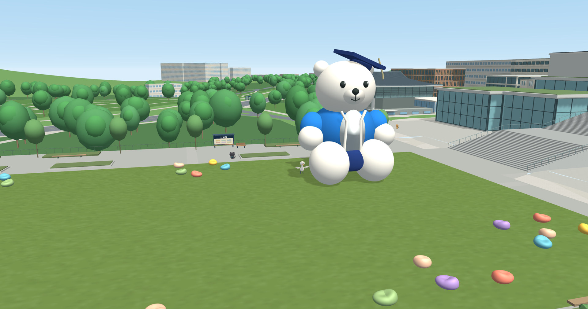

<sub>브라우저 속 실시간 3D 캠퍼스 · 서울대학교 관악캠퍼스를 배경으로 한 비공식 프로젝트</sub>

</div>

<p align="center"><sub>프로토타입 개발 · 2026.11.11–2026.11.16</sub></p>

<br>

## 초기와 현재

기본 지형과 보행 경로에서 시작해 건물 외관, 조경, 셔틀과 상호작용을 추가했습니다.

<p align="center">
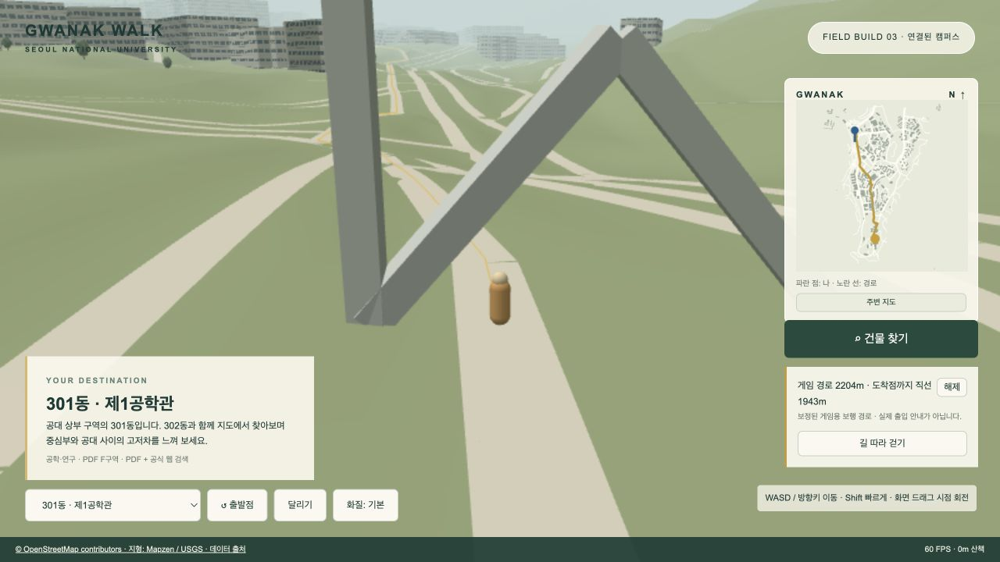
&nbsp;
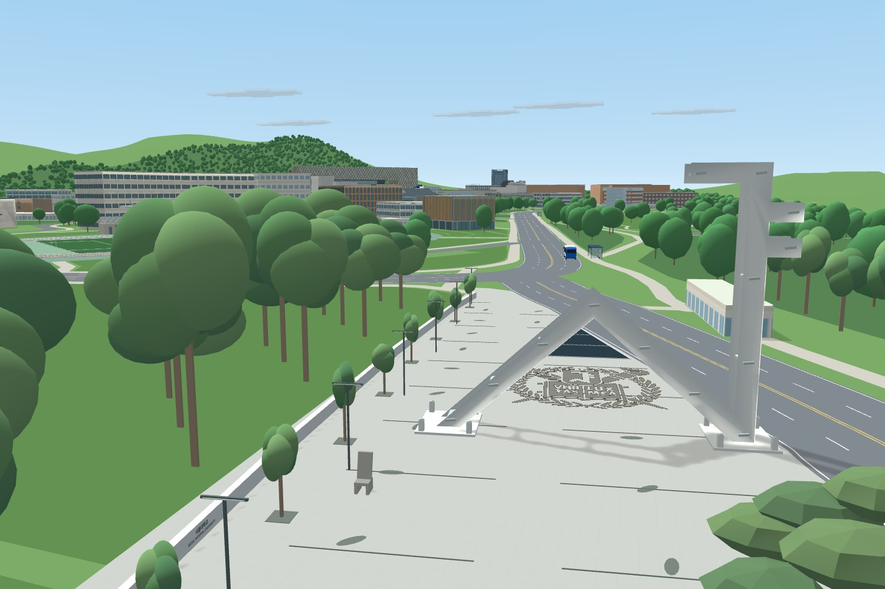
</p>

**초기 · BUILD003** → **현재 · 타이틀 배경**

<sub>왼쪽은 11월 11일 BUILD003 캡처, 오른쪽은 BUILD104에서 촬영한 현재 타이틀 이미지입니다. 같은 장소이며 구도와 UI 표시 여부는 다릅니다.</sub>

<br>

## 주요 기능

<p align="center">
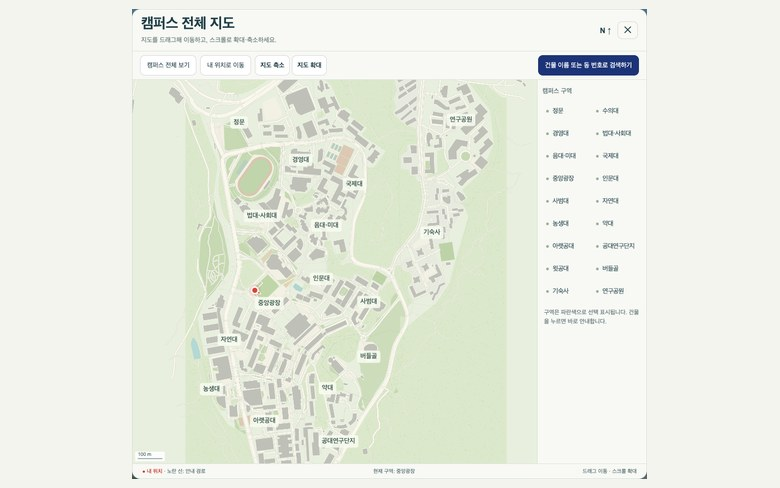
&nbsp;
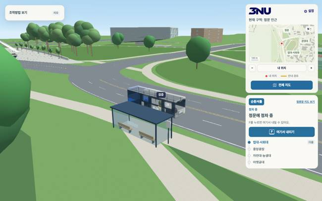
</p>

**지도와 길안내**<br>
건물 이름·동 번호로 검색하고, 건물 소개와 목적지까지의 경로를 확인합니다. 전체 지도와 미니맵에는 캠퍼스 구역을 표시합니다.

**순환셔틀**<br>
6대의 버스가 14개 정류장을 순환합니다. 도착 시간 확인, 대기 후 자동 탑승, 다음 정류장 하차 예약을 지원합니다.

<br>

<p align="center">
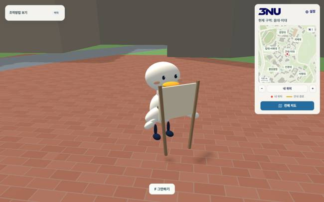
&nbsp;
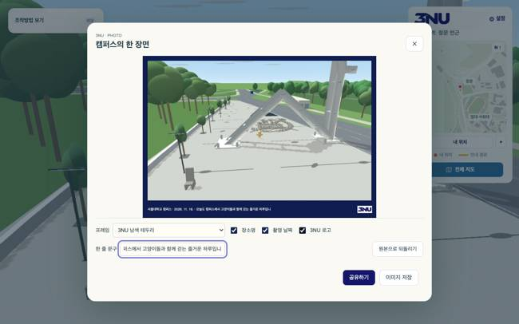
</p>

**NPC와 상호작용**<br>
고양이 NPC와 10개 상호작용 지점을 배치했습니다. 잔디광장의 빈백에 앉거나 캠퍼스 곳곳의 활동을 이용할 수 있습니다.

**사진 촬영과 편집**<br>
UI를 제외한 화면을 촬영하고 프레임과 문구를 더합니다. 이미지 저장과 지원 환경에서의 공유 기능을 제공합니다.

**로그인 없는 멀티플레이어**<br>
닉네임과 캐릭터를 선택해 다른 사용자와 이동·동작을 공유합니다. 지도·카메라·설정은 각자 조작합니다.

<br>

## 캐릭터

### 플레이어

<p align="center">

&nbsp; &nbsp; &nbsp;

</p>

<p align="center"><strong>백학</strong> · 비행, 상승과 하강 &nbsp; / &nbsp; <strong>리오</strong> · 걷기, 점프와 웅크리기</p>

캐릭터는 설정에서 전환할 수 있습니다. 이동속도, 카메라 거리, 표시 거리와 화질도 조절할 수 있습니다.

### NPC

의상과 소품이 다른 여섯 종류의 고양이가 캠퍼스에 등장합니다.

<p align="center">
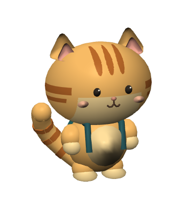

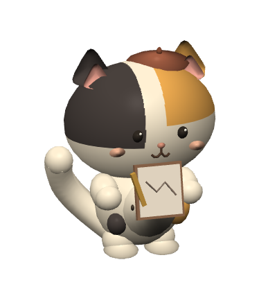
</p>

<p align="center"><strong>치즈</strong> · 통학 &nbsp; / &nbsp; <strong>턱시도</strong> · 독서 &nbsp; / &nbsp; <strong>삼색이</strong> · 미술</p>

<p align="center">
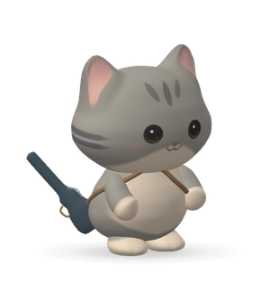
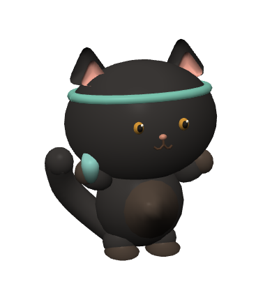

</p>

<p align="center"><strong>고등어</strong> · 음악 &nbsp; / &nbsp; <strong>검은 고양이</strong> · 운동 &nbsp; / &nbsp; <strong>크림</strong> · 휴식</p>

<br>

## 기술 구성

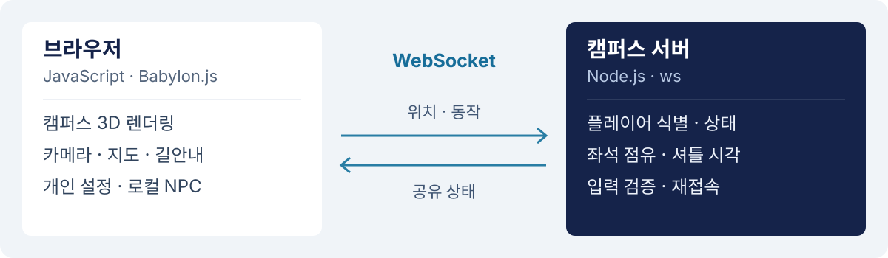

<br>

**클라이언트** · JavaScript, Babylon.js, HTML/CSS<br>
**서버와 통신** · Node.js, WebSocket (`ws`)<br>
**공간 데이터** · OpenStreetMap 기반 건물·도로, 지형 참고 데이터, 공식 캠퍼스 자료 대조<br>
**검증** · Node.js 테스트, Playwright, 프레임·드로콜 계측

장면과 지도 자산은 브라우저에서 렌더링하며, 서버에는 플레이어 상태와 상호작용 메시지를 전송합니다. 서버가 전체 물리 시뮬레이션을 수행하는 구조는 아닙니다.

<br>

## 설계와 검증

### 주요 설계 결정

**계정 없이 시작하기**<br>
가입 절차 없이 닉네임과 캐릭터를 선택해 접속합니다. 닉네임과 서버 식별자는 분리했습니다.

**공유하는 상태와 개인 조작 나누기**<br>
좌석 점유와 셔틀 시각은 서버가 관리합니다. 지도·길안내·카메라·설정은 각자 유지합니다. 동일 좌석의 동시 요청, 연결 단절 후 점유 해제와 재접속을 검증했습니다.

**표시 거리를 선택하기**<br>
건물·조경 등의 표시 거리를 5단계로 나누고 기본값을 3단계로 정했습니다. 보이는 범위와 렌더링 부담을 사용 환경에 맞게 조절합니다.

<br>

### 이동 동기화와 표시 비용 관리

플레이어 상태는 10Hz로 전송하고 원격 캐릭터는 110ms 보간을 적용합니다. 서버 관심 범위와 클라이언트 표시 거리를 사용하며, 원격 모델의 기하·재질을 공유합니다. 셔틀 탑승자는 차량 ID와 상대 위치로 표현합니다. 관련 로컬 코드는 멀티플레이어 클라이언트 (`dist/multiplayer106.js`), 서버 (`server/local106.cjs`), 서버 테스트 (`scripts/multiplayer106.test.cjs`)에서 확인할 수 있습니다.

### 초기 장면 생성의 긴 멈춤 완화

장면 생성 작업을 나눠 브라우저에 실행 시간을 돌려주고, 동일한 지붕 재질을 공유했습니다. 건물·지형 2,081개 항목의 형상·재질 대응은 유지했습니다.

| 로컬 비교 | BUILD103 | BUILD104 |
|---|---:|---:|
| 최대 메인 스레드 작업 | 4,469ms | **503ms** |
| 재질 수 | 1,340개 | **1,301개** |
| 첫 장면 표시 | 5.751초 | 5.698초 |

측정 조건은 Apple M5, Chrome 157 headless, 1280×800·DPR 1, 표준 화질입니다. 첫 장면 표시 시간 차이는 작아 전체 로딩 시간 단축으로 해석하지 않았습니다. 구현은 [장면 초기화](dist/app.js)와 [지형 생성](dist/ground-surface.js)에 있습니다.

### 검증 범위 구분

독립 브라우저 컨텍스트 3개에서 동작 공유·좌석 경쟁·버스 탑승·단절 복구를 확인했습니다. 별도로 가상 연결 20개와 원격 모델 19개 추가 렌더링을 검사했습니다. 이는 실제 기기 20대 또는 공개 인터넷 환경의 성능 검증과 구분합니다. 실행 절차와 상태 관리 규칙은 로컬 멀티플레이어 문서 (`docs/LOCAL_MULTIPLAYER.md`)에 정리했습니다.

<br>

## 제작 과정과 역할


<br>

개인 프로젝트로 기획, 기능 요구사항 정의, UI·상호작용 설계, 구현 우선순위 결정과 시안 검수를 주도했습니다. 코드·자산 제작과 반복 검증에는 AI 코딩 도구를 활용했습니다. 요구사항을 화면별 동작, 예외 조건, 유지해야 할 기능과 완료 기준으로 나눠 전달하고, 실제 결과를 확인하며 수정했습니다.

### AI 에이전트 역할 분담

- **제작자** — 기능과 범위 결정, 시안 비교·수정, 구현 결과 검수와 공개 여부 판단
- **기획·검토 담당 에이전트** — 요구사항 정리, 시안·구현 인계 자료 작성, 진행 상태와 검증 범위 확인
- **메인 구현 에이전트** — 앱·서버 통합, 기능 구현, 회귀 검사와 빌드별 기록
- **분야별 담당 에이전트** — 버스·고양이 외형, 모바일 시안, README 등 분리 가능한 작업. 홍보영상은 별도 담당으로 인계해 진행 중

분리한 결과물은 메인 작업본에서 통합·검증했습니다. 로컬 검증, GitHub 반영, 공개 배포는 별도 단계로 관리했습니다.

<details>
<summary><strong>요구사항을 구체화하고 검수한 사례</strong></summary>

**지도 표시와 선택 동작**<br>
미니맵의 시설 선택은 막되, 전체 지도에서는 점 표시를 없애도 시설 영역 선택과 길안내를 유지하도록 구분했습니다. 같은 데이터라도 화면별 표시와 입력 동작이 달라야 한다는 조건을 명시했습니다.

**캐릭터 상태에 따른 조작 안내**<br>
백학에게는 상승·하강, 리오에게는 점프·웅크리기만 표시하도록 요청했습니다. 길어진 안내 문구를 줄이면서 실제 입력과 화면 안내가 일치하도록 수정했습니다.

**셔틀 탑승 흐름과 검수 기준**<br>
정류장에서 대기를 선택하면 자동 탑승하고, 탑승 중에는 다음 정류장 하차를 예약하도록 흐름을 정했습니다. 대기 상태처럼 내용이 가장 긴 경우에도 데스크톱 안내창에 스크롤이 없어야 한다는 확인 기준을 제시했습니다.

</details>

<br>

## 로컬 실행

현재 GitHub 코드와 최신 로컬 작업본은 버전이 다릅니다. 아래 Node.js 실행 절차는 서버 코드와 `package.json`이 포함된 최신 로컬 작업본 기준입니다. 저장소에 반영된 코드만 실행하려면 아래의 정적 서버 방식을 사용합니다.

**Node.js 24 이상과 npm**이 있는 환경에서 저장소 루트에서 실행합니다.

```sh
npm ci --ignore-scripts
npm start
```

브라우저에서 **[http://127.0.0.1:8766](http://127.0.0.1:8766)** 을 열고 닉네임과 캐릭터를 선택합니다. 같은 로컬 서버를 여러 브라우저 창에서 열면 멀티플레이어를 확인할 수 있습니다. 종료는 터미널에서 `Ctrl+C`입니다.

<details>
<summary><strong>정적 서버로 혼자 탐방하기</strong></summary>

```sh
python3 -m http.server 8765 --bind 127.0.0.1 --directory dist
```

[http://127.0.0.1:8765](http://127.0.0.1:8765)에서 실행합니다. 별도 번들 컴파일은 필요하지 않습니다. 이 방식에서는 멀티플레이어 서버 연결 안내가 잠시 표시되며 혼자 탐방할 수 있습니다.

</details>

<details>
<summary><strong>개발 문서와 프로젝트 구조</strong></summary>

| 경로 | 역할 |
|---|---|
| `dist/` | 실시간 3D 앱, UI, 현재 사용하는 모델 데이터와 자산 |
| `server/` | 로컬 멀티플레이어 서버 |
| `source-data/` | 재생성에 필요한 입력 |
| `scripts/` | 유지보수·생성·검증 도구 |
| `docs/` | 실행, 출처, 보관 및 복구 문서 |

로컬 멀티플레이어 (`docs/LOCAL_MULTIPLAYER.md`) · [현재 작업 트리](docs/CURRENT_WORKTREE.md) · [저장 규칙](docs/STORAGE_POLICY.md) · [복구 안내](docs/RECOVERY.md)

이 소개는 BUILD106까지 완료된 로컬 기능을 기준으로 합니다. 공개 사이트와 로컬 작업본은 자동으로 동기화되지 않습니다. 보고서와 검증 캡처는 저장소 밖에서 관리합니다.

</details>

<br>

<details>
<summary><strong>키보드 조작</strong></summary>

| 키 | 동작 |
|---|---|
| <kbd>W</kbd> <kbd>A</kbd> <kbd>S</kbd> <kbd>D</kbd> / 방향키 | 이동 |
| <kbd>Space</kbd> / <kbd>E</kbd> | 백학 상승 · 리오 점프 |
| <kbd>Q</kbd> / <kbd>C</kbd> | 백학 하강 · 리오 웅크리기 |
| <kbd>Shift</kbd> | 가속 |
| <kbd>F</kbd> | 가까운 대상과 상호작용 |
| <kbd>M</kbd> | 전체 지도 |
| <kbd>L</kbd> | 사진 찍기 |
| <kbd>P</kbd> | 설정 |

</details>

---

<details>
<summary><strong>출처와 이용 범위</strong></summary>

3NU는 서울대학교 관악캠퍼스를 배경으로 한 **비공식 프로젝트**입니다.

[전체 출처](dist/credits.html) · [권리 검토](docs/RIGHTS_REVIEW.md) · [라이브러리 및 라이선스](dist/vendor)

지도 데이터와 라이브러리의 라이선스는 애플리케이션 코드와 별개입니다. 프로젝트 전체에 별도의 오픈소스 라이선스를 부여하지 않았습니다. 학교 상징을 포함한 자산은 관련 권리를 각각 확인해야 하며, 참고 사진·개인 작업 기록·검증 보고서는 업로드 대상에서 제외합니다.

</details>

<div align="center">
<br>
<strong>3NU</strong><br>
<sub>서울대학교 3D 캠퍼스 익스플로러</sub>
</div>
